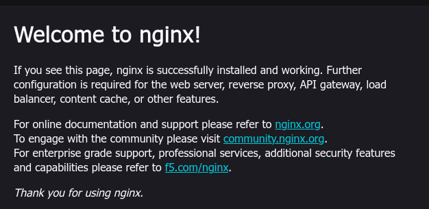

# TP Docker

## Compte rendu exercice manipulation de base des conteneurs

### Step 1

```bash
❯ docker --version
Docker version 29.9.3, build 5457199
```

### Step 2

```bash
❯ docker images
                                                                                                                                                                                                                            i Info →   U  In Use
IMAGE   ID             DISK USAGE   CONTENT SIZE   EXTRA
```

### Step 3

```bash
❯ docker pull hello-world
Using default tag: latest
latest: Pulling from library/hello-world
4f55086f7dd0: Pull complete
d5e71e642bf5: Download complete
Digest: sha256:c567b231f65614688711a75f31518a064258a51d442117a3e771a3a8fdba78ef
Status: Downloaded newer image for hello-world:latest
docker.io/library/hello-world:latest
```

### Step 4

```bash
❯ docker run hello-world

Hello from Docker!
This message shows that your installation appears to be working correctly.

To generate this message, Docker took the following steps:
 1. The Docker client contacted the Docker daemon.
 2. The Docker daemon pulled the "hello-world" image from the Docker Hub.
    (amd64)
 3. The Docker daemon created a new container from that image which runs the
    executable that produces the output you are currently reading.
 4. The Docker daemon streamed that output to the Docker client, which sent it
    to your terminal.

To try something more ambitious, you can run an Ubuntu container with:
 $ docker run -it ubuntu bash

Share images, automate workflows, and more with a free Docker ID:
 https://hub.docker.com/

For more examples and ideas, visit:
 https://docs.docker.com/get-started/

```

### Step 5

```bash
❯ docker ps
CONTAINER ID   IMAGE     COMMAND   CREATED   STATUS    PORTS     NAMES
```

### Step 6

```bash
❯ docker ps -a
CONTAINER ID   IMAGE         COMMAND    CREATED         STATUS                     PORTS     NAMES
1d5055564397   hello-world   "/hello"   2 minutes ago   Exited (0) 2 minutes ago             elastic_visvesvaraya
```

### Step 7

```bash
❯ docker rm 1d5055564397
1d5055564397
```

### Step 8

```bash
❯ docker rmi hello-world
Untagged: hello-world:latest
Deleted: sha256:c567b231f65614688711a75f31518a064258a51d442117a3e771a3a8fdba78ef
```

## Compte rendu exercice création d'un serveur web avec Docker

### Step 1

```bash
❯ docker pull nginx
Using default tag: latest
latest: Pulling from library/nginx
6d2e43921e9e: Pull complete
7cb4701ce7cd: Pull complete
bbb080c71d50: Pull complete
1724c05f72c6: Pull complete
37fb86c2a767: Pull complete
512ac5e7ce8e: Pull complete
1962e1ff75b4: Pull complete
d2c7e31f04a3: Download complete
4582dace95e2: Download complete
Digest: sha256:165ddde8751e75a1c907d24ef10d9f6deb08b57e0fe56caf67512486aff76d82
Status: Downloaded newer image for nginx:latest
docker.io/library/nginx:latest
```

### Step 2

```bash
❯ docker run -d -p 8080:80 --name mon_nginx nginx
1d0729dda358e3b0261db82f3a218aaf0fe95e745582430147f2a2d82e780b80
```

### Step 3

```bash
❯ docker ps
CONTAINER ID   IMAGE     COMMAND                  CREATED              STATUS              PORTS                                     NAMES
1d0729dda358   nginx     "/docker-entrypoint.…"   About a minute ago   Up About a minute   0.0.0.0:8080->80/tcp, [::]:8080->80/tcp   mon_nginx
```

### Step 4



### Step 5

```bash
❯ docker stop mon_nginx
mon_nginx
❯ docker rm mon_nginx
mon_nginx
```

## Compte endu exercie déploiement d'une application Python Flask

### Step 3

```bash
❯ docker build -t e3-app .
[+] Building 6.7s (8/8) FINISHED                                                                                                                                                                                           docker:desktop-linux
 => [internal] load build definition from dockerfile                                                                                                                                                                                       0.0s
 => => transferring dockerfile: 178B                                                                                                                                                                                                       0.0s
 => [internal] load metadata for docker.io/library/python:3.12-slim-trixie                                                                                                                                                                 0.5s
 => [internal] load .dockerignore                                                                                                                                                                                                          0.0s
 => => transferring context: 165B                                                                                                                                                                                                          0.0s
 => [internal] load build context                                                                                                                                                                                                          0.1s
 => => transferring context: 256B                                                                                                                                                                                                          0.0s
 => CACHED [1/4] FROM docker.io/library/python:3.12-slim-trixie@sha256:5e2bdb1b0d542d5039cffb8181c65930093949194a65c365dfb1b0fe13a4fa5b                                                                                                    0.1s
 => => resolve docker.io/library/python:3.12-slim-trixie@sha256:5e2bdb1b0d542d5039cffb8181c65930093949194a65c365dfb1b0fe13a4fa5b                                                                                                           0.1s
 => [2/4] COPY . .                                                                                                                                                                                                                         0.1s
 => [3/4] RUN pip install --no-cache-dir -r requirements.txt                                                                                                                                                                               3.4s
 => exporting to image                                                                                                                                                                                                                     2.1s
 => => exporting layers                                                                                                                                                                                                                    0.9s
 => => exporting manifest sha256:7ae67bab3b87db06fc9c60723794a6e6a513c0eacde0a35eecb2cf5ec904dfa2                                                                                                                                          0.1s
 => => exporting config sha256:225cc276b71d106d801cf180b80951e7c60e6daf9cbfbaa66656f44d6f3ec5d2                                                                                                                                            0.1s
 => => exporting attestation manifest sha256:8be48f0dd13e46102bb505d79c5951c13a7c27585e3d50095f26033fa7cc979d                                                                                                                              0.1s
 => => exporting manifest list sha256:d5e3e8ad6dee355c511169e7f24e5e1b7a17bb4a3eca7a0e4121af2b4dbff852                                                                                                                                     0.1s
 => => naming to docker.io/library/e3-app:latest                                                                                                                                                                                           0.0s
 => => unpacking to docker.io/library/e3-app:latest
```
